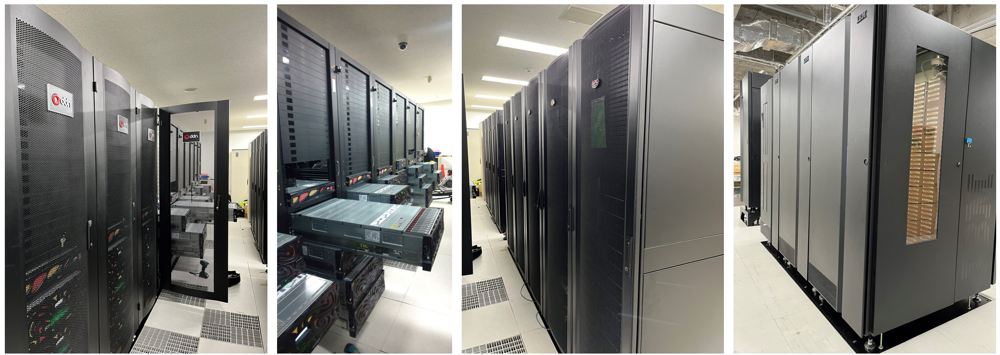

# 遺伝研スーパーコンピュータ(2025)


国立遺伝学研究所は生命・医学系研究における情報処理のための大規模計算基盤として、大規模クラスタ型計算機・大規模メモリ共有型計算機・大容量高速ディスク装置を備えた最新鋭のスーパーコンピュータシステムサービスを提供しています。





:::warning
ディスク容量が逼迫しているためユーザーホームディレクトリ内のデータについて当研究所ではバックアップを取っておりません。利用者の責任においてバックアップを取っていただくようお願いいたします。
:::


## 重要なお知らせ {#featured-news}


- [遺伝研スパコンのNode.js脆弱性対応のお知らせ](/blog/2026-10-23-nodejs-vulnerability) (2026.10.23) ＼ &#x1F195; ／
- [遺伝研スパコンからの重要なお知らせ : 2025年第3期(12～3月)](/blog/2026-02-26-important_notice_2025_Dec-2026_Mar) (2026.02.26) 


## 年度末アカウント継続申請について {#year-end-renewals}


現在、アカウント申請システムのセキュリティー対策のためにシステムの書き換えを行っており、
再公開まで時間がかかっております。アカウント継続申請はアカウント申請システムの再公開後に行います。
2024年度に関しましては、スパコン(2025)へのアカウント継続は、申請なしでも、スパコン管理者側で行います。


## 2026 年度の定期メンテナンス等 {#2026-annual-maintenance}

分かり次第、お知らせします。


## 2022 年 5 月 13 日(金) 個人ゲノム解析区画および一般解析区画大規模ユーザのアカウントの新規登録受付の一時停止 {#registration-suspension}

平素より、遺伝研スパコンをご利用いただき誠にありがとうございます。

現在、スパコンの計算リソースが CPU,ディスクとも非常に逼迫しているため、以下のユーザのアカウントの新規登録を一時停止させていただきます。

- 一般解析区画の大規模利用ユーザのアカウントの新規登録
- 個人ゲノム解析区画ユーザのアカウントの新規登録

以下の申請についてはこれまで通り受け付けます。

- 現在すでに一般解析区画の大規模利用ユーザである方々、 個人ゲノム解析区画のユーザである方々に付きましては、利用計画表の変更による利用リソースの追加はこれまで通り受け付けます。
- また、一般解析区画の通常のユーザー登録についてもこれまで通り受け付けます。その場合はディスクは初期設定の 1TB までの利用となります。
- 講習会などでの利用ついてもこれまで通り受け付けます。


その場合も、ご希望に添えない場合がありますのでご了承いただけますようお願いいたします。

アカウントの新規登録受付の再開時期につきましては、 計算リソースの空き状況を見ながら決めていくこととなります。４ヶ月ごとの空き状況の見通しを随時ホームページから公開しますので、利用を希望される方は空き状況の見通しを参考に、予め利用計画表を提出してください。ただし、空き状況は確定ではありませんのでご希望に添えない場合がありますのでご了承願います。


## 謝辞について {#acknowledgement}

遺伝研スーパーコンピュータシステムの活動は皆様の謝辞で評価されています。当スーパーコンピュータシステムを利用した論文が採択された際には以下の記載例を参考に謝辞への記載をお願いします。

記載例

```
==============================================

　　＜謝辞　英語＞
　　Computations were partially performed on the NIG supercomputer
　　at ROIS National Institute of Genetics.

==============================================

　　＜謝辞　日本語＞
　　本研究は、情報・システム研究機構 国立遺伝学研究所が
    有する遺伝研スーパーコンピュータシステムを利用しました。

================================================

```
