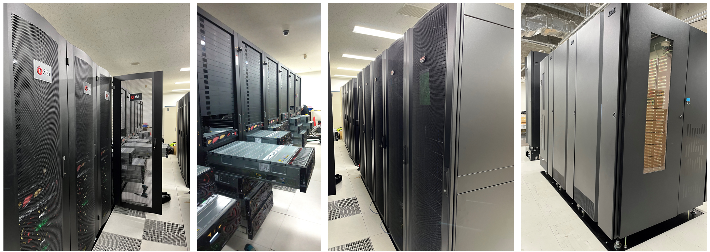

# NIG Supercomputer(2025)

The National Institute of Genetics (NIG) provides a cutting-edge supercomputer system equipped with large-scale cluster-based computation, large-scale shared memory computation, and high-capacity high-speed disk devices, serving as a large-scale computational infrastructure for information processing in life sciences and medical research.




:::warning
Due to limited disk capacity, the research institute does not back up data in users' home directories. Users are responsible for backing up their data.
:::

## Featured News {#featured-news}

- [[Urgent] Network Outage Due to Emergency Network Maintenance on Thursday, November 5, 2026](/blog/2026-11-05-network) (November 2, 2026) ＼ &#x1F195; ／
- [Notice on Node.js Vulnerability Response on the NIG Supercomputer](/blog/2026-10-23-nodejs-vulnerability) (October 23, 2026) ＼ &#x1F195; ／
- [[Important Notice] Critical Vulnerabilities in PHP and Node.js, and the eMudhra Intermediate CA Key Leak](/blog/2026-10-23-security-issues) (October 23, 2026) ＼ &#x1F195; ／
- [Important Notice from the NIG Supercomputer: Third Period of 2025 (December–March)](/blog/2026-02-26-important_notice_2025_Dec-2026_Mar) (February 26, 2026) 


## Year-End Account Renewal Applications {#year-end-renewals}

The account application system is currently being revised for security enhancements, which is causing a delay in its reopening. Account renewal applications will be processed after the system is reopened. For 2024FY, account renewal for the supercomputer(2025) will be handled by the supercomputer administrator without use's application.


## Regular Maintenance in Fiscal Year 2026 {#2026-annual-maintenance}

Further details will be announced in due course.


## Temporary Suspension of New Account Registrations for Large-Scale Users in General and Personal Genome Analysis Areas (May 13, 2022) {#registration-suspension}

Thank you for using the NIG supercomputer.

Due to the supercomputer's computational resources being highly constrained in terms of both CPU and disk, new account registrations for the following users will be temporarily suspended:

- Large-scale users in the general analysis area
- Users in the personal genome analysis area

The following applications will continue to be accepted:

- Additional resource usage requests for users who are already large-scale users in the general analysis area or personal genome analysis area.
- Regular user registrations for the general analysis area. In this case, disk usage is limited to an initial setting of up to 1TB.
- Applications for workshop usage will also continue to be accepted.

However, we ask for your understanding as it may not always be possible to meet your requests.

The resumption of new account registrations will be decided based on the availability of computational resources. Updates on the availability will be published on the homepage every four months. Prospective users are requested to refer to these updates and submit their usage plans in advance. Please note that the availability forecasts are not guaranteed, and requests may not always be fulfilled.


## Acknowledgements {#acknowledgement}

The activities of the NIG supercomputer system are evaluated through the acknowledgements received. If a paper utilizing this supercomputer system is accepted, please include an acknowledgement using the examples below.

Examples:

```
==============================================

<English Acknowledgement>
Computations were partially performed on the NIG supercomputer
at ROIS National Institute of Genetics.

==============================================

<Japanese Acknowledgement>
本研究は、情報・システム研究機構 国立遺伝学研究所が
有する遺伝研スーパーコンピュータシステムを利用しました。

================================================
